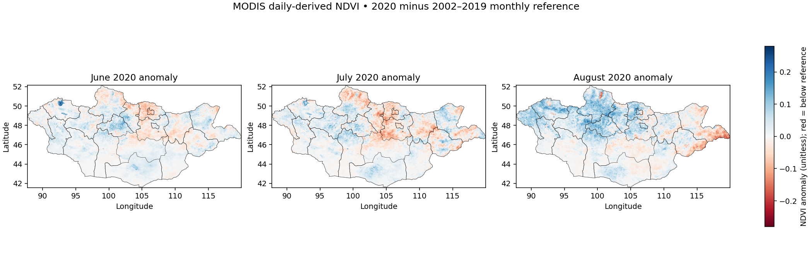
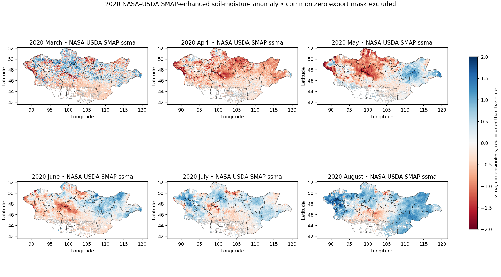
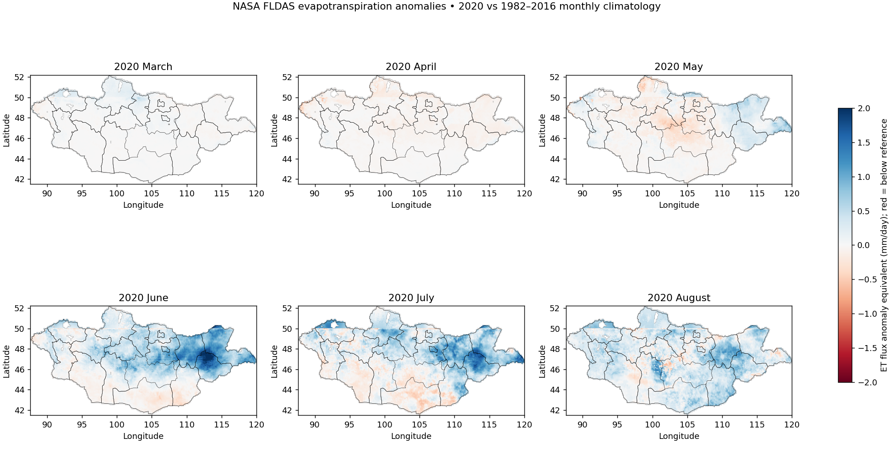
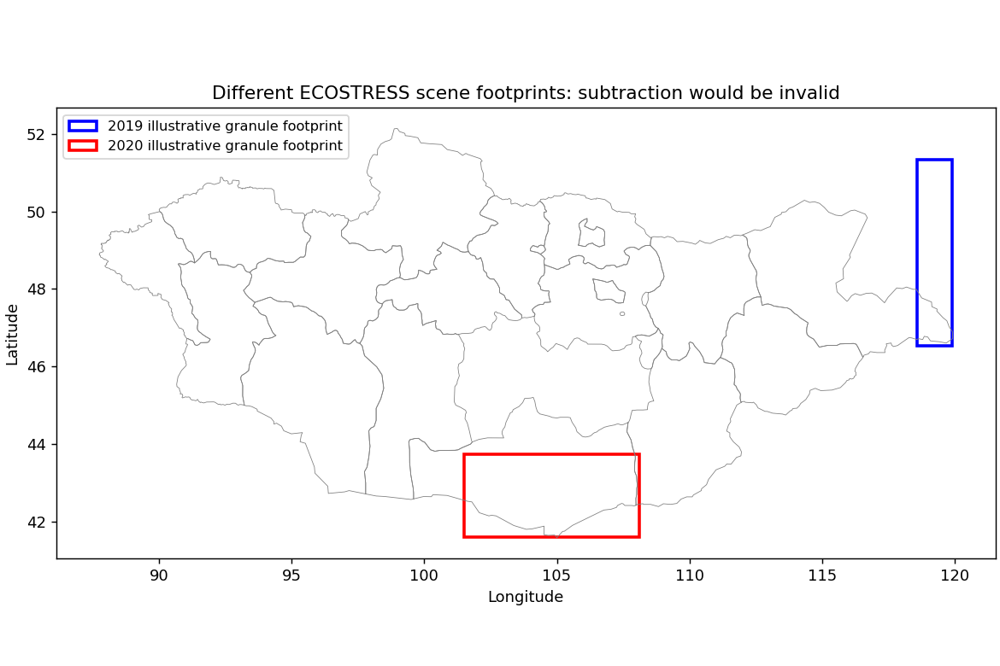
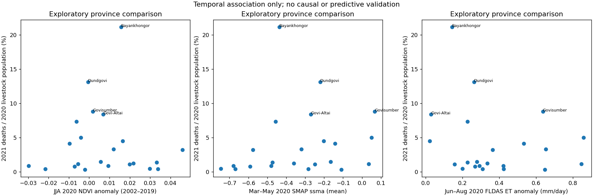

# Research results at a glance | Mongolia dzud satellite research

> Part of the **Mongolia Dzud (NASA/JPL, 2022)** project. Project overview: [MONGOLIA.md](MONGOLIA.md) · Portfolio home: [README](../README.md)

**Aster Volta · Original JPL fellowship research (2022), independently reconstructed figures and code (2026)**

> **Research question.** Can vegetation, soil moisture and evapotranspiration observed during summer help characterize the environmental context preceding severe winter livestock losses in Mongolia?

The analysis is observational and exploratory. It is **not** a dzud forecast or a causal model. Maps and graphs below come from archived real data; each is linked to the corresponding executable notebook.

## 1. Did summer vegetation differ from a historical reference?

**Method.** Recompute a separate mean for June, July and August from original MODIS-derived 2002–2019 observations (18 years per month, 54 rasters total), then subtract each matching monthly reference from 2020. The original annual rasters are preserved separately; three derived references and a SHA256 source manifest are packaged.

**Finding.** NDVI departures are heterogeneous: some regions/months show greener conditions, others reduced vegetation index. **Interpretation.** The satellite record does not justify a single national summer-vegetation narrative. **Limitations.** NDVI is an indirect proxy for forage; original upstream daily per-pixel quality masks could not be revalidated. [Open notebook 05](../notebooks/05_MODIS_NDVI_True_2002_2019_Anomalies.ipynb).

## 2. What did the soil-moisture anomalies show?

**Method.** Map the six individually dated 2020 SMAP SSMA rasters, calculate provincial means over valid cells, and report data coverage. **Finding.** Geographic soil-moisture departures shift across months. **Interpretation.** Timing and valid geographic coverage matter. **Limitations.** Missing observations in some provinces can materially affect region summaries. [Open notebook 02](../notebooks/02_NASA_USDA_SMAP_2020_Actual_Maps.ipynb).

## 3. What additional water-balance signal appears in evapotranspiration?

**Method.** Analyze original FLDAS March–August 2020 GeoTIFFs, first validating their actual raster-band metadata. These particular files are **already climatological anomalies** relative to 1982–2016; kg m⁻² s⁻¹ is converted to mm/day equivalent. **Finding.** The spatial and monthly departures vary across Mongolia. **Interpretation.** ET contributes a complementary modeled water-balance perspective. **Limitations.** FLDAS model output should not be equated directly with ground-measured pasture conditions. [Open notebook 06](../notebooks/06_FLDAS_ET_True_2020_Anomalies.ipynb).

## 4. Can the ECOSTRESS years be compared directly?

**Method.** Recover original 2019/2020 ECO3ETPTJPL.001 scene-level statistics (283 and 358 scene records) and inspect two sample original ET footprints. **Finding.** The selected years have different acquisition footprints, dates and valid-pixel distributions. **Interpretation.** A naive annual mean comparison would confound environmental change with where and when the instrument sampled. **Limitations.** The reconstructed scene statistics are **not** a co-located year-over-year change analysis; original LST/ESI investigation is not independently reconstructed. [Open notebook 03](../notebooks/03_ECOSTRESS_ET_Real_2019_2020.ipynb).

## 5. Do these summer indicators simply explain next year's livestock losses?

**Method.** Rebuild 2021 mortality as **2021 reported deaths ÷ 2020 livestock population × 100**, join 22 geographic reporting units to the 2020 satellite statistics, and assess Spearman correlations, leave-one-out variability and SMAP-coverage sensitivity. **Finding.** For **2020 summer NDVI historical anomalies**, the association with 2021 mortality is approximately **Spearman ρ = 0.000565** across 22 areas. **Interpretation.** This narrow comparison provides no simple monotonic evidence that NDVI anomalies alone determine livestock losses. **Limitations.** One outcome year, only 22 areas, possible spatial dependence, plus winter snow/cold, livestock-management and disease factors: **not causal or predictive validation**. [Open notebook 04](../notebooks/04_Mongolia_Mortality_and_Multisensor_Comparison.ipynb).

## What I would investigate next

A scientifically useful follow-up would explicitly model winter cold/snow/icing mechanisms, prior pasture availability and geographically matched observations across multiple event years, with uncertainty and external validation. The original 2022 work also explored GLDAS and ECOSTRESS LST/ESI, but those **specific** historical analyses are not claimed to have been reproduced in this curated package.

## Reproduce or inspect

- [Full Mongolia project documentation and execution instructions](MONGOLIA.md)
- [Data provenance, units and source archive](SOURCE_PROVENANCE.md)
- [Scientific interpretation caveats](SCIENTIFIC_SCOPE.md)
- [Verified code and results](../results/NOTEBOOK_EXECUTION_REPORT.json)

**Attribution:** Original 2022 JPL research by Aster Volta, with mentors Dr. Erika Podest, Dr. Kerry Cawse-Nicholson and Dr. Kyle McDonald; independently reviewed/reconstructed code in 2026. Satellite data remain attributable to NASA and relevant product teams. This is neither a peer-reviewed paper nor a JPL institutional publication.
